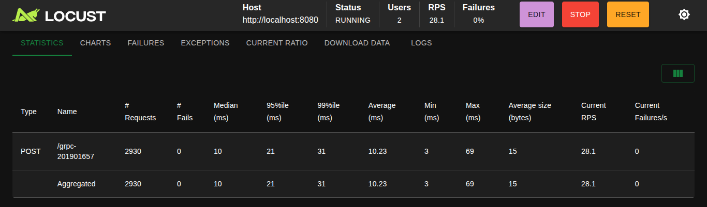

# Manual Técnico y Guía de Instalación

## Índice

1. [Arquitectura general](#1-arquitectura-general)
2. [Infraestructura (entorno local con kind)](#2-infraestructura-entorno-local-con-kind)
3. [Zot: registry con HTTPS](#3-zot-registry-con-https)
4. [Gateway API](#4-gateway-api)
5. [API REST en Rust y HPA](#5-api-rest-en-rust-y-hpa)
6. [Servicios en Go: REST, gRPC y concurrencia](#6-servicios-en-go-rest-grpc-y-concurrencia)
7. [RabbitMQ](#7-rabbitmq)
8. [Consumer y modelo de datos en Valkey](#8-consumer-y-modelo-de-datos-en-valkey)
9. [Operator (Valkey y Grafana)](#9-operator-valkey-y-grafana)
10. [Dashboard de Grafana](#10-dashboard-de-grafana)
11. [OCI Artifact](#11-oci-artifact)
12. [Falco](#12-falco)
13. [Pruebas de carga y análisis](#13-pruebas-de-carga-y-análisis)
14. [Guía de instalación paso a paso](#14-guía-de-instalación-paso-a-paso)

---

## 1. Arquitectura general

### Flujo completo de datos

1. **Locust** genera un JSON aleatorio y hace `POST /grpc-201901657` a `localhost:8080`.
2. El puerto 8080 del host está mapeado por kind al NodePort **30080**, que es el servicio de **Envoy Gateway**.
3. El **HTTPRoute** `grpc-route` reescribe la ruta a `/report` y envía a `rust-api:8080`.
4. **rust-api** valida el país y reenvía por HTTP a `go-client:8081/report`.
5. **go-client** convierte el JSON a mensaje protobuf y llama por **gRPC** a `go-server:50051`.
6. **go-server** publica el mensaje en la cola durable `war_reports` de **RabbitMQ**.
7. **go-consumer** lee de la cola con 4 workers concurrentes, procesa y escribe en **Valkey**.
8. **Grafana** (con el plugin `redis-datasource`) consulta Valkey y dibuja el dashboard.

| Nombre | Contenido |
|---|---|
| `munk8s` | rust-api, go-client, go-server, go-consumer, rabbitmq, valkey, grafana, Gateway y HTTPRoute |
| `envoy-gateway-system` | Controlador y proxy de Envoy Gateway |
| `operator-system` | Operator (controller manager) |
| `falco` | Falco |

## 2. Infraestructura (entorno local con kind)

| Elemento | Versión / valor |
|---|---|
| Clúster | kind v0.24.0, Kubernetes v1.31.0, un nodo `munk8s-control-plane` |
| Gateway API (CRDs) | v1.2.1 estándar |
| Envoy Gateway | v1.2.1 (Helm) |

Configuración de kind (`k8s/kind-config.yaml`): mapea el NodePort 30080 al puerto 8080 del host (tráfico de Locust) y el 30443 al 8443 (Grafana).

```yaml
kind: Cluster
apiVersion: kind.x-k8s.io/v1alpha4
nodes:
  - role: control-plane
    extraPortMappings:
      - containerPort: 30080
        hostPort: 8080
        protocol: TCP
      - containerPort: 30443
        hostPort: 8443
        protocol: TCP
```

**Nodo y pods del clúster**<br>


---

## 3. Zot: registry con HTTPS

Zot corre como **contenedor Docker fuera del clúster**, conectado a la red `kind`, con certificado autofirmado y puerto 5000. Todas las imágenes se llaman `zot:5000/munk8s/<componente>:<tag>`.

### Publicación

```bash
docker build -t zot:5000/munk8s/rust-api:2 rust-api/
docker push zot:5000/munk8s/rust-api:2
curl --cacert ~/zot/certs/zot.crt https://zot:5000/v2/_catalog
```

### Consumo desde el clúster

`kubectl` no valida certificados: lo hace **containerd** del nodo. Por eso se configura el nodo para confiar en el certificado:

1. Se copia `zot.crt` a `/etc/containerd/certs.d/zot:5000/ca.crt` dentro del nodo.
2. Se crea `hosts.toml` apuntando a `https://zot:5000`.
3. Se activa `config_path = "/etc/containerd/certs.d"` en `/etc/containerd/config.toml` y se reinicia containerd.

Todo está automatizado en `k8s/zot/trust-kind.sh`, que debe ejecutarse **cada vez que se recrea el clúster**.

**Catálogo de Zot en terminal**</br>


**Catálogo de Zot en el navegador**</br>
.png)

**Contenedor de Zot corriendo y fuera del clúster**</br>


**Un pod descargando su imagen desde Zot**</br>


---

## 4. Gateway API

Se usa **Kubernetes Gateway API** con **Envoy Gateway**.

Fragmento del HTTPRoute (`k8s/route-hpa.yaml`):

```yaml
rules:
  - matches:
      - path:
          type: PathPrefix
          value: /grpc-201901657
    filters:
      - type: URLRewrite
        urlRewrite:
          path:
            type: ReplaceFullPath
            replaceFullPath: /report
    backendRefs:
      - name: rust-api
        port: 8080
```

Camino de red: `localhost:8080` (host) → NodePort 30080 → `targetPort 10080` de Envoy → HTTPRoute → `rust-api`.

**Gateway, HTTPRoute y GatewayClass**</br>


**Estado aceptado de la ruta**</br>


**Petición de prueba a través del Gateway**</br>

---

## 5. API REST en Rust y HPA

### Recursos y HPA

```yaml
resources:
  requests: { cpu: 100m, memory: 64Mi }
  limits:   { cpu: 500m, memory: 128Mi }
```

El HPA necesita `requests.cpu` para calcular el porcentaje. Se instala `metrics-server` con `--kubelet-insecure-tls`.

```yaml
apiVersion: autoscaling/v2
kind: HorizontalPodAutoscaler
spec:
  scaleTargetRef: { apiVersion: apps/v1, kind: Deployment, name: rust-api }
  minReplicas: 1
  maxReplicas: 3
  metrics:
    - type: Resource
      resource:
        name: cpu
        target: { type: Utilization, averageUtilization: 30 }
```

**HPA y Deployments**</br>


**HPA escalando bajo carga**</br>


**Pods de Rust escalados**</br>


---

## 6. Servicios en Go: REST, gRPC y concurrencia

### Contrato gRPC (`proto/war.proto`)

```proto
syntax = "proto3";
package wartweets;
option go_package = "munk8s/proto;proto";

message WarReportRequest {
  Countries country = 1;
  int32 warplanes_in_air = 2;
  int32 warships_in_water = 3;
  string timestamp = 4;
}
enum Countries { countries_unknown = 0; usa = 1; rus = 2; chn = 3; esp = 4; gtm = 5; }
message WarReportResponse { string status = 1; }
service WarReportService { rpc SendReport (WarReportRequest) returns (WarReportResponse); }
```

### go-client

- Servidor HTTP en `:8081` (`/health`, `/report`).
- Decodifica el JSON, valida el país (`pb.Countries_value`) y llama a `SendReport` por gRPC a `go-server:50051` con **timeout de 5 s**.
- **Concurrencia:** `net/http` atiende cada petición en su propia goroutine, y un único `grpc.ClientConn` multiplexa llamadas concurrentes sobre HTTP/2.

### go-server

- Servidor gRPC en `:50051`.
- Al iniciar, reintenta conectarse a RabbitMQ hasta 30 veces (cada 2 s) y declara la cola durable `war_reports`.
- `SendReport` serializa el reporte a JSON y lo publica con `PublishWithContext`. Devuelve `status: ok`.
- gRPC ejecuta cada llamada en su propia goroutine.

### Comunicación REST/gRPC

**Logs de los tres servicios**</br>


**Archivo .proto**</br>


---

## 7. RabbitMQ

**Pods y cola**</br>


---

## 8. Modelo de datos en Valkey

### Modelo de datos

| Clave | Tipo | Contenido | Uso en el dashboard |
|---|---|---|---|
| `count:{PAIS}` | string | Reportes por país | Reportes recibidos (ESP) |
| `max:planes`, `min:planes`, `max:ships`, `min:ships` | string | Extremos globales (Lua) | 4 stats |
| `zset:planes`, `zset:ships` | zset | Suma por país | (respaldo del top) |
| `top:planes`, `top:ships` | hash | País → total acumulado | Top de países |
| `freq:planes`, `freq:ships` | hash | Valor → frecuencia | Base de la moda |
| `mode:planes`, `mode:ships` | string | Moda (recalculada cada ~200 reportes) | Moda |
| `ts:ESP` | stream | Serie del país asignado (MAXLEN ~5000, TTL 24 h) | (respaldo) |
| `tsmin:planes`, `tsmin:ships` | hash | `HH:MM` → último valor de ESP en ese minuto (TTL 24 h) | Evolución temporal |
| `assigned:country` | string | `ESP` (se crea a mano, ver §16) | País asignado |

**Datos en Valkey**</br>


---

## 9. Operator (Valkey y Grafana)

Se construyó con **Operator SDK**.

### Creación

```bash
cd operator
operator-sdk init --plugins helm --domain munk8s.io --group cache --version v1alpha1 --kind ValkeyInstance
operator-sdk create api --group cache --version v1alpha1 --kind GrafanaInstance
```

### Diseño

| Elemento | Detalle |
|---|---|
| Grupo / versión | `cache.munk8s.io/v1alpha1` |
| CRDs | `ValkeyInstance`, `GrafanaInstance` |
| Mapeo CRD → chart | `watches.yaml` |
| Charts | `helm-charts/valkeyinstance`, `helm-charts/grafanainstance` |
| Despliegue | Deployment `operator-controller-manager` en `operator-system` |
| Imagen | `zot:5000/munk8s/valkey-operator:<tag>` (publicada en Zot) |

`watches.yaml`:

```yaml
- group: cache.munk8s.io
  version: v1alpha1
  kind: ValkeyInstance
  chart: helm-charts/valkeyinstance
- group: cache.munk8s.io
  version: v1alpha1
  kind: GrafanaInstance
  chart: helm-charts/grafanainstance
```

### Lógica de reconciliación

El helm-operator observa los Custom Resources. Cuando uno se **crea o modifica**, renderiza su chart con los valores de `spec` (los `spec` sobrescriben `values.yaml`) y aplica el resultado con `helm install/upgrade`; cuando se **elimina**, ejecuta `helm uninstall` y retira los recursos. El estado de cada release se guarda en Secrets (`secrets: *` en el RBAC). Si alguien borra un recurso hijo, la siguiente reconciliación lo recrea.

Custom Resource (`k8s/valkey-instance.yaml`):

```yaml
apiVersion: cache.munk8s.io/v1alpha1
kind: ValkeyInstance
metadata:
  name: valkey
  namespace: munk8s
spec:
  maxmemory: 128mb
```

Custom Resource (`k8s/grafana-instance.yaml`):

```yaml
apiVersion: cache.munk8s.io/v1alpha1
kind: GrafanaInstance
metadata:
  name: grafana
  namespace: munk8s
spec:
  valkeyHost: valkey:6379
```

### RBAC

El `ClusterRole` del Operator concede permisos sobre `valkeyinstances` y `grafanainstances` (con `/status` y `/finalizers`), y sobre `services`, `serviceaccounts`, `configmaps`, `persistentvolumeclaims`, `deployments` y `statefulsets`.

### Persistencia comprobada

**Operator corriendo**<br>


**Custom Resources y recursos que el Operator creó**</br>


**Archivos del Operator**</br>


---

## 10. Dashboard de Grafana

URL: `http://localhost:8443` (usuario `admin`, contraseña `admin`).

| Panel | Visualización | Origen (Valkey) |
|---|---|---|
| Máx. aviones en aire | Stat | `GET max:planes` |
| Mín. aviones en aire | Stat | `GET min:planes` |
| Máx. barcos en mar | Stat | `GET max:ships` |
| Mín. barcos en mar | Stat | `GET min:ships` |
| Top países: aviones | Bar gauge | `HGETALL top:planes` |
| Top países: barcos | Bar gauge | `HGETALL top:ships` |
| Moda de aviones | Stat | `GET mode:planes` |
| Moda de barcos | Stat | `GET mode:ships` |
| País asignado | Stat | `GET assigned:country` (ESP) |
| Reportes recibidos (ESP) | Stat | `GET count:ESP` |
| Evolución temporal (Aviones) | Bar gauge | `HGETALL tsmin:planes` |
| Evolución temporal (Barcos) | Bar gauge | `HGETALL tsmin:ships` |


**Dashboard completo con datos**</br>


**Pod de Grafana creado por el Operator**</br>


---

## 11. OCI Artifact

Se publica en Zot un **archivo de configuración de entrada** como OCI Artifact, y **Locust lo consume** para generar la carga.

**Archivo:** `locust/config.json`

```json
{"countries":["USA","RUS","CHN","ESP","GTM"],"planes_max":50,"ships_max":30}
```

Define los países y los rangos máximos de los reportes. `locustfile.py` lo lee al iniciar (si no existe, usa valores por defecto equivalentes).

### Publicar y descargar

```bash
# Publicar
oras push --ca-file ~/zot/certs/zot.crt zot:5000/munk8s/config:1 locust/config.json:application/json

# Descargar (en otra carpeta)
mkdir -p /tmp/oras-test && cd /tmp/oras-test
oras pull --ca-file ~/zot/certs/zot.crt zot:5000/munk8s/config:1
cat locust/config.json

# Usarlo en Locust
cp /tmp/oras-test/locust/config.json ~/Escritorio/201901657_LAB_SO1_2S2026/proyecto3/locust/config.json
```

---

## 12. Falco

### Instalación

```bash
helm repo add falcosecurity https://falcosecurity.github.io/charts
helm repo update
helm upgrade --install falco falcosecurity/falco -n falco --create-namespace \
  --set driver.kind=modern_ebpf --set tty=true --set falcosidekick.enabled=false \
  --set falco.rule_matching=all \
  -f k8s/falco-rules.yaml
```

### Regla personalizada (`k8s/falco-rules.yaml`)

```yaml
customRules:
  munk8s-rules.yaml: |-
    - rule: Lectura de archivo sensible en pods munk8s
      desc: Detecta lectura de /etc/shadow o /app/secretos dentro de contenedores
      condition: >
        open_read and container
        and (fd.name = /etc/shadow or fd.name startswith /app/secretos)
      output: >
        ALERTA munk8s: lectura de archivo sensible
        (archivo=%fd.name proceso=%proc.name cmd=%proc.cmdline
        pod=%k8s.pod.name ns=%k8s.ns.name contenedor=%container.name)
      priority: WARNING
      tags: [munk8s, filesystem]
```

### Simulación de la amenaza

```bash
kubectl exec -n munk8s deploy/rust-api -- cat /etc/shadow > /dev/null
```

Alerta obtenida:

```
03:45:00.317793639: Warning ALERTA munk8s: lectura de archivo sensible (archivo=/etc/shadow proceso=cat cmd=cat /etc/shadow pod=rust-api-666ff874c9-5nwgx ns=munk8s contenedor=rust-api)
```

**Falco corriendo**</br>


**Regla cargada dentro del pod de Falco**</br>


**Alerta de la regla personalizada**</br>


---

## 13. Pruebas de carga y análisis

### Prueba 1: HPA

| Métrica | Resultado |
|---|---|
| Peticiones | 39 421 |
| Fallos | 0 |
| RPS | ~307 |
| Mediana / p95 / p99 | 5 ms / 36 ms / 54 ms |
| Rust | Escaló de 1 a **3 réplicas** (CPU 109 % → ~38–40 %) |
| Cola RabbitMQ al final | 47 750 mensajes (aún sin consumer) |

### Prueba 2: con 1 réplica vs 2 réplicas

Misma carga en ambas: `locust --headless -u 50 -r 10 -t 2m`.

| Métrica | 1 réplica | 2 réplicas |
|---|---|---|
| Peticiones totales | 69 936 | 67 868 |
| Fallos | 0 | 0 |
| RPS | 581.3 | 566.6 |
| Mediana | 23 ms | 24 ms |
| p95 | 38 ms | 45 ms |
| p99 | 51 ms | 59 ms |
| Máximo | 564 ms | 174 ms |

**Uso de CPU durante la prueba con 2 réplicas (`kubectl top`):**

| Pod | CPU | Memoria |
|---|---|---|
| go-server-…-cc525 | 55m | 13Mi |
| go-server-…-j5wkb | 1m | 1Mi |
| rust-api-…-5nwgx | 32m | 5Mi |
| rust-api-…-bdc8q | 1m | 1Mi |
| rust-api-…-tg9dq | 14m | 1Mi |

### Análisis

1. **Añadir una segunda réplica no mejoró el rendimiento** (−2.5 % de RPS, p95 +7 ms). Esa diferencia está dentro de la variación normal entre dos corridas de 2 minutos.
2. **El tráfico no se repartió.** Una réplica de `go-server` usó 55m de CPU y la otra 1m. `go-client` mantiene **una conexión HTTP/2 gRPC persistente** y kube-proxy balancea **por conexión**, no por petición; por eso casi todas las llamadas llegan al mismo pod. Rust mostró el mismo efecto (32m / 14m / 1m) por las conexiones keep-alive entre Envoy y los pods.
3. **El cuello de botella es el equipo**, no `go-server`. Locust, el clúster, RabbitMQ, el consumer, Grafana y Falco comparten 4 núcleos, y Locust avisó "CPU usage was too high" en ambas pruebas.
4. **Cómo mejorarlo:** Service *headless* para `go-server` con balanceo del lado del cliente (`round_robin`) o un proxy L7 que balancee por petición; y ejecutar Locust en otra máquina.

</br>

**Interfaz web de Locust**</br>




---

## 14. Guía de instalación paso a paso

### 14.1 Requisitos

Ubuntu con Docker, `kubectl`, `helm`, `kind`, Go, Rust (`cargo`), `protoc` con `protoc-gen-go` y `protoc-gen-go-grpc`, `operator-sdk`, `oras`, y Python 3 con `locust` (en un entorno virtual).

### 14.2 Clúster y Gateway API

```bash
cd proyecto3
kind create cluster --name munk8s --config k8s/kind-config.yaml
kubectl create namespace munk8s

kubectl apply -f https://github.com/kubernetes-sigs/gateway-api/releases/download/v1.2.1/standard-install.yaml
helm install eg oci://docker.io/envoyproxy/gateway-helm --version v1.2.1 \
  -n envoy-gateway-system --create-namespace
kubectl wait --timeout=5m -n envoy-gateway-system deployment/envoy-gateway --for=condition=Available

kubectl apply -f k8s/envoyproxy.yaml
kubectl apply -f k8s/gateway.yaml
```

### 14.3 Zot con HTTPS

```bash
mkdir -p ~/zot/certs ~/zot/data
openssl req -x509 -newkey rsa:4096 -nodes -days 365 \
  -keyout ~/zot/certs/zot.key -out ~/zot/certs/zot.crt \
  -subj "/CN=zot" -addext "subjectAltName=DNS:zot,DNS:localhost,IP:127.0.0.1"

docker run -d --name zot --restart unless-stopped --network kind -p 5000:5000 \
  -v $(pwd)/k8s/zot/config.json:/etc/zot/config.json:ro \
  -v ~/zot/certs:/certs:ro -v ~/zot/data:/var/lib/zot \
  ghcr.io/project-zot/zot-linux-amd64:latest serve /etc/zot/config.json

echo "127.0.0.1 zot" | sudo tee -a /etc/hosts
sudo mkdir -p /etc/docker/certs.d/zot:5000
sudo cp ~/zot/certs/zot.crt /etc/docker/certs.d/zot:5000/ca.crt

./k8s/zot/trust-kind.sh
```

### 14.4 Construir y publicar imágenes

```bash
docker build -t zot:5000/munk8s/rust-api:2 rust-api/ && docker push zot:5000/munk8s/rust-api:2

for s in go-client go-server go-consumer; do
  docker build -f $s/Dockerfile -t zot:5000/munk8s/$s:1 .
  docker push zot:5000/munk8s/$s:1
done
```

### 14.5 Despliegue de la aplicación

```bash
kubectl apply -f k8s/rabbitmq.yaml
kubectl apply -f k8s/apps.yaml
kubectl apply -f k8s/route-hpa.yaml

kubectl apply -f https://github.com/kubernetes-sigs/metrics-server/releases/latest/download/components.yaml
kubectl patch deployment metrics-server -n kube-system --type=json \
  -p='[{"op":"add","path":"/spec/template/spec/containers/0/args/-","value":"--kubelet-insecure-tls"}]'
```

### 14.6 Operator, Valkey y Grafana

```bash
cd operator
make docker-build IMG=zot:5000/munk8s/valkey-operator:5
docker push zot:5000/munk8s/valkey-operator:5
make deploy IMG=zot:5000/munk8s/valkey-operator:5
kubectl rollout status deployment/operator-controller-manager -n operator-system
cd ..

kubectl apply -f k8s/valkey-instance.yaml
kubectl wait --for=condition=Ready pod/valkey-0 -n munk8s --timeout=180s
kubectl exec -n munk8s valkey-0 -- valkey-cli set assigned:country ESP 

kubectl apply -f k8s/consumer.yaml
kubectl apply -f k8s/grafana-instance.yaml
```

### 14.7 Falco

```bash
./k8s/falco-install.sh
```

### 14.8 OCI Artifact y Locust

```bash
oras push --ca-file ~/zot/certs/zot.crt zot:5000/munk8s/config:1 locust/config.json:application/json
source ~/locust-env/bin/activate
locust -f locust/locustfile.py --host http://localhost:8080
```

### 14.9 Después de reiniciar el equipo

```bash
docker ps                           
kubectl config use-context kind-munk8s
kubectl get pods -A                 
```

Si Zot no arrancó: `docker start zot`. Si Envoy responde `500` al inicio, esperar unos segundos.

### 14.10 Verificación rápida de punta a punta

```bash
curl -i -X POST localhost:8080/grpc-201901657 -H 'Content-Type: application/json' \
  -d '{"country":"ESP","warplanes_in_air":42,"warships_in_water":14,"timestamp":"2026-03-12T20:15:30Z"}'
kubectl exec -n munk8s valkey-0 -- valkey-cli get count:ESP
```
